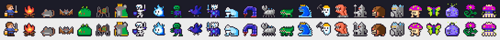
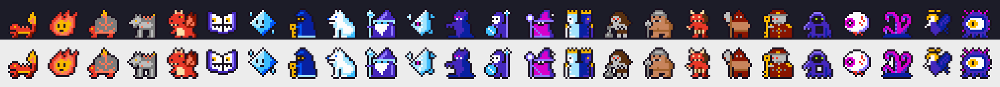

# 灯火迷宮(tomoshibi)

Claudeが応答を作っている間だけ灯がともり、勇者が地下へ潜っていく放置型ダンジョンRPGです。Claude Codeのmod(function hooksのプラグイン)として動きます。

- 応答待ちの間は1.5秒ごとに戦闘が進み、入力欄の上の帯にドット絵の勇者と敵、階、Lv、体力、直近の出来事が出ます。
- 待っていない間は帯が1行になり、前回の待ち時間で得た経験値・金・撃破数を出します。
- 進行は自動で保存され、セッションをまたいで続きから遊べます。
- ローグライクではありません。敗れても経験値・金・装備は失わず、2階上へ戻って休むだけです。
- レベルと階に上限はなく、10階ごとに景色と敵が変わります。100階を越えると同じ景色を「弐」「参」と深さを増して巡り直します。





勇者と焚き火、10の景色に5体ずつ(うち1体は10階ごとに現れる階の主)の敵を、16x16ドットのファミコン風に描いています。端末では半角ブロック、デスクトップアプリではSVGで描きます。

## 入れ方

ターミナルのClaude Codeのプロンプトで次を打ちます。

```
/plugin install tomoshibi --marketplace jnk0vc/tomoshibi
```

マーケットプレイスの追加を聞かれたら`y`で答え、入れる範囲(ユーザー単位など)を選びます。デスクトップアプリのCodeタブではこのコマンドを使えませんが、ターミナルでユーザー単位に入れたmodはデスクトップアプリのセッションでも読み込まれます。

Claude Code 2.1.295で動作を確認しています。modの仕組み自体が先行公開中の機能なので、ほかの版では動かない場合があります。

## 遊び方

| 操作 | 内容 |
| --- | --- |
| Claudeに何か頼む | 応答を待つ間だけ探索が進む |
| `/tomoshibi` | 詳しい画面(ペイン)を開く・閉じる。応答中でもすぐ開く |
| 帯の「開く」 | ペインを開く |

ペインでは次の操作ができます。キーはペインにフォーカスがあるときに効きます。

| キー | 操作 |
| --- | --- |
| `w` | 武器を鍛える(金を使う) |
| `a` | 防具を鍛える(金を使う) |
| `u` / `d` | 浅い階・深い階へ移る(深い側は到達済みの階まで) |
| `m` | 「階段を見つけたら降りる」と「この階で稼ぐ」を切り替える |

育成方針(攻撃・防御・体力・均等)を選ぶと、レベルが上がるたびに3ポイントがその方針で振られます。勇者の剣と鎧の色は、装備を10段階鍛えるごとに変わります。

## ランキング(任意)

参加すると、名前・Lv・最深階・総経験値・撃破数・探索時間をランキングサーバーへ送り、Lv・最深階・総経験の順位表を見られます。記録を送るのは、ペインで名前を入れて参加したあとだけです。抜けるとサーバー上の記録も消えます。参加していなくても、ペインを開くと順位表を読み込みます。

既定では、作者が公開しているサーバー(`https://tomoshibi-ranking.jankovic.workers.dev`、Cloudflare WorkersとD1)につながります。ランキングの通信を一切したくない場合は、プラグイン設定の`rankingUrl`を空にします。自分で立てたサーバーを使う場合は、そのURLを入れます。

## 開発

| パス | 内容 |
| --- | --- |
| `hooks/register.tsx` | フック、タイマー、帯とペインの描画、保存、ランキングの通信 |
| `hooks/game.ts` | ゲームの進行(戦闘、レベル、装備、階)。`$`に触れない純粋関数 |
| `hooks/sprites.ts` | ドット絵を端末用のRasterとデスクトップ用のSvgに変換する |
| `hooks/art.ts` | 16x16のドット絵データ |
| `hooks/ranking.ts` | ランキングの入力検証と応答の検証 |
| `types/index.d.ts` | `$.state`に置く値の型 |
| `tests/` | `claude plugin test`で動くテスト |

```
claude plugin validate .
claude plugin test .
```

開発中のmodを手元のフォルダから読み込むときは、`claude --plugin-dir <このフォルダ>`で起動します。

## ライセンス

MIT License。全文は[LICENSE](LICENSE)にあります。
